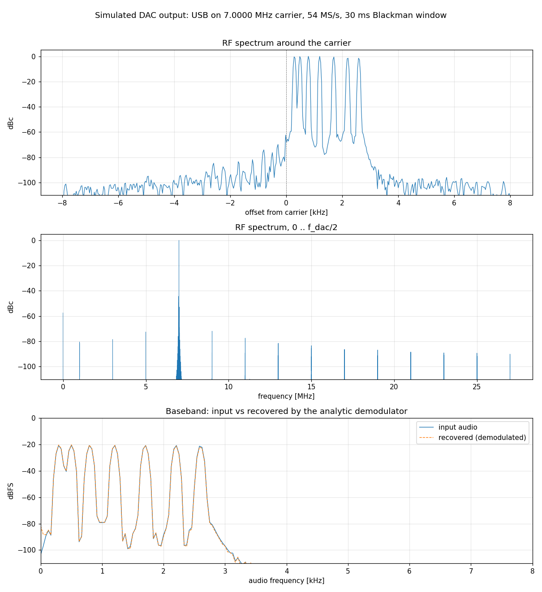
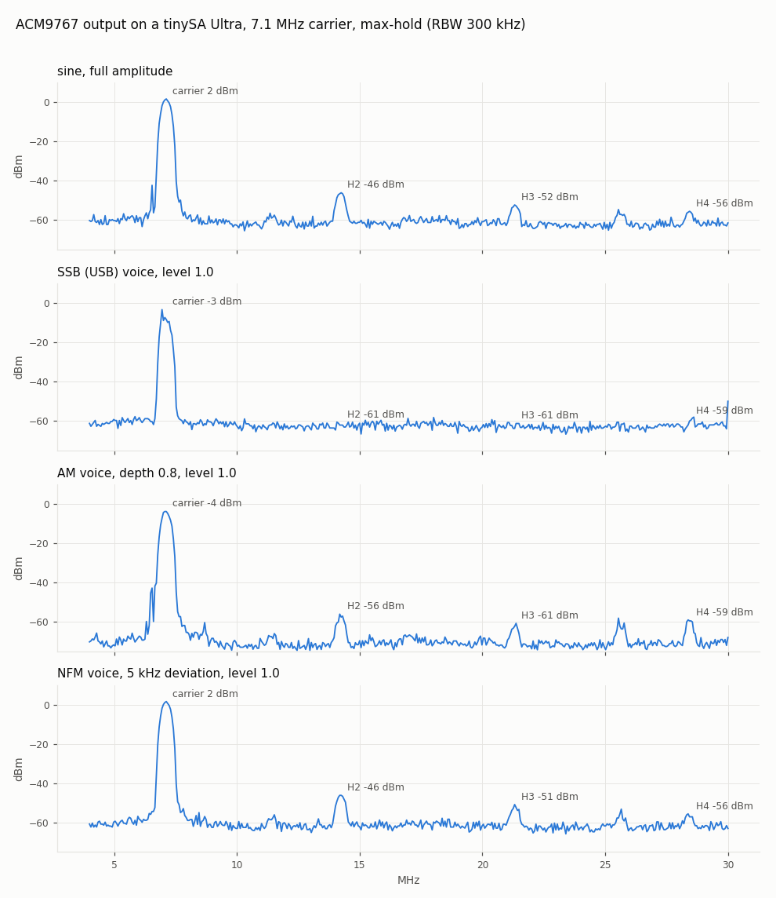
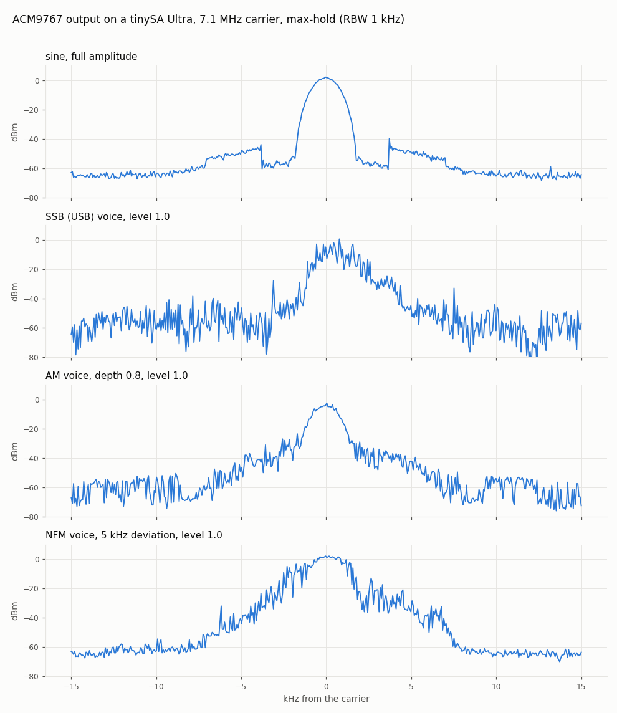

# Tang Nano 9K + ACM9767 dual DAC generator

Gowin GW1NR-9C (Sipeed Tang Nano 9K) gateware that drives an **ACM9767**
high-speed DAC module (Analog Devices AD9767, 2 x 14-bit, up to 125 MSPS,
+-5 V outputs) as a two-channel arbitrary-frequency signal generator, with
host control over the board's USB UART using Modbus RTU.

* Two independent DDS channels: sine (4096-point quarter-wave ROM), triangle, sawtooth,
  square with programmable duty, or DC; 32-bit frequency tuning word
  (sub-Hz resolution), 16-bit phase offset, amplitude, signed DC offset and
  per-channel polarity inversion.
* 108 MS/s DAC sample rate from the on-chip PLL (set in `platform.json`):
  the logic runs at 54 MHz and computes two samples per clock, and OSER4
  serializers send them to the module at 108 MHz, with CLK and WRT coming out
  of the same serializers so the data transitions are centred on the WRT
  latch edge and CLK is half a sample ahead of it. `dac.samples_per_clock = 1`
  builds the one-sample-per-clock 54 MS/s ODDR version instead (bit-identical
  datapath, a fallback for long wiring).
* Modbus RTU slave on `/dev/ttyGowin` (1 Mbaud 8-E-1, id 7); all channel
  settings are staged in holding registers and applied atomically by a COMMIT.
* **SSB, AM and FM modulation of audio streamed from the PC**: 16 kS/s 16-bit samples go
  over the same Modbus link into a 2048-sample FIFO; a 127-tap Hilbert
  transformer + 3-stage CIC interpolator build the analytic baseband, mixed
  onto channel 1's DDS carrier (USB or LSB); the same baseband also drives AM
  (settable depth, carrier at half scale) and FM (settable deviation, 5 kHz
  NFM default, phase-accumulator modulation). Simulated unwanted-sideband and
  carrier suppression: better than 80 dB (the DAC and the module's analogue
  stage will set the real figure).
* `scripts/acm9767_ctl.py` -- host CLI in physical units (Hz, fraction of full
  scale, degrees); `stream` sends a WAV file or test tones as SSB.
* Icarus Verilog test suite (unit + an end-to-end Modbus-to-DAC test through
  the real top level with the Gowin PLL/CLKDIV/OSER4 models), driven by CTest; host
  tests with pytest against a fake slave; and a **modulator-to-demodulator
  loopback** (`ctest -L loopback`): the real modulator chain is simulated on
  a binary audio file, its 108 MS/s DAC codes are dumped as binary and decoded
  by an analytic-signal demodulator in Python (`scripts/ssb_loopback.py`),
  which scores SNR, sideband and carrier suppression for USB/LSB/AM/FM.

The build/test/program flow and the sim harness are lifted from
[tang_nano_9K_ov7670](https://github.com/phoenix367/tang_nano_9K_ov7670), as
are the UART and Modbus RTU slave cores.

## Prerequisites

| Component                    | Notes                                                             |
| ---------------------------- | ----------------------------------------------------------------- |
| Gowin EDA `V1.9.12.x` Linux  | IDE + Programmer. Needed even for simulation (`simlib/gw1n/prim_tsim.v`) |
| Icarus Verilog 12+           | `apt install iverilog`                                            |
| CMake 3.16+                  | `apt install cmake`                                               |
| Python 3.10+ (+ pyserial)    | host CLI; `pip install -r scripts/requirements.txt`               |

## Build, test, program

```sh
cmake -S . -B build -D IVerilog_PATH=/usr/bin -D Gowin_PATH=/opt/Gowin_V1.9.12.02_SP2_linux/IDE
cmake --build build                 # compile every testbench
(cd build && ctest)                 # run the simulation suite
cmake --build build --target hw_all       # synthesis + PnR + bitstream -> impl/pnr/acm9767_demo.fs
cmake --build build --target hw_program   # load into SRAM (volatile)
cmake --build build --target hw_program_flash   # persist in embedded flash
```

`Gowin_PATH` must be the IDE folder (the one with `bin/GowinSynthesis` and
`simlib/`). The four `loopback_*` tests take ~4 min each with `-j4` (they
simulate 40 ms of audio, 8.7 M DAC samples at 108 MS/s, and score them with
FFTs of that length, ~1-1.5 GB RAM each); `ctest -LE loopback` runs the quick
suite (~4 min, dominated by `integration_top_ssb_stream`). Run
one by hand, e.g. with a real recording and the recovered audio written out:

```sh
scripts/ssb_loopback.py --sim build/sim/tests/unit/ssb_baseband/loopback/unit_ssb_baseband_loopback.bin \
    --mode lsb --carrier 7.1e6 --wav voice.wav --seconds 0.1 --save-wav --workdir build/loopback/voice
``` Other targets: `hw_synth`, `hw_impl`, `sine_lut` (regenerate the
sine ROM), per-test `<name>_BUILD` / `<name>_SIM`. Configure options:
`-D DUMP_SIM_VARIABLES=ON` writes `dump.vcd` per test, `-D SimLogLevel=Debug`
raises the testbench verbosity.

On Linux install `udev/99-gowin-ft2232h.rules` once so the programmer can open
the JTAG channel and the UART shows up as `/dev/ttyGowin`:

```sh
sudo install -m 644 udev/99-gowin-ft2232h.rules /etc/udev/rules.d/
sudo udevadm control --reload-rules   # then replug the board
```

## Wiring

See [doc/wiring.md](doc/wiring.md) for the pin table. Short version: only
channel 1 is wired -- data on left-header pins 25 26 27 28 29 30 33 34 40 35
41 42 51 53, CLK1 on 54, WRT1 on 55. All are 3.3 V pins; the 1.8 V pins 79-86
must not be used for the DAC. Remap by editing `src/acm9767.cst`; channel 2
comes back with `dac.channels = 2` in `platform.json` plus the commented
`da2_*` block in the constraints.

## Host control

```sh
scripts/acm9767_ctl.py status
scripts/acm9767_ctl.py set 1 --freq 1e6 --wave sine --amp 1.0
scripts/acm9767_ctl.py set 2 --freq 100e3 --wave square --duty 0.25 --offset 0.1
scripts/acm9767_ctl.py enable 1 2
scripts/acm9767_ctl.py invert 1 --on        # if the output polarity is backwards
scripts/acm9767_ctl.py read 0x10 7          # raw registers
```

```sh
scripts/acm9767_ctl.py stream --carrier 7.1e6 --tone 1000 --seconds 5   # 1 kHz tone as USB on 7.1 MHz
scripts/acm9767_ctl.py stream --carrier 7.1e6 --lsb --wav voice.wav     # a WAV file (any rate/channels) as LSB
scripts/acm9767_ctl.py stream --tone 700 --tone2 1900 --level 0.45      # two-tone test on the current carrier
scripts/acm9767_ctl.py stream --carrier 1e6 --mode am --depth 0.8 --wav voice.wav    # AM
scripts/acm9767_ctl.py stream --carrier 10.7e6 --mode nfm --tone 1000            # NFM, 5 kHz deviation
scripts/acm9767_ctl.py set 1 --freq 1e6 --wave am --depth 0.5                    # mode without streaming
scripts/acm9767_ctl.py skew 1 1130          # even/odd skew calibration (raw, or --ps 160); `skew 1` shows it
```



*Simulated DAC output (54 MS/s build) for seven tones (300-2600 Hz) as USB on a 7 MHz
carrier: the wanted sideband at 0 dBc, the suppressed sideband and carrier
below -60 dBc, the 1 MHz-spaced quantisation comb below -70 dBc across the
band, and the demodulated baseband overlaying the input. Reproduce with
`scripts/ssb_loopback.py` followed by `scripts/plot_spectrum.py`.*

### Measured spectra

Real output of the board (2026-09-16 build, 54 MS/s) into a tinySA Ultra, direct
connection, the module's output gain trimmer turned down so that a
full-amplitude sine gives about +2 dBm into 50 Ω (with the trimmer at maximum
the module's op-amp stage compresses: -18 dBc second harmonic at 7 MHz).
Max-hold over eight sweeps per trace; the voice is a 16 kHz mono recording
looped at `--level 1.0`, so the SSB and AM traces include the limiter and the
start/stop of every pass. Captured and plotted with `scripts/tinysa_spectra.py`.



| mode, 7.1 MHz carrier | carrier | H2 (14.2 MHz) | H3 (21.3 MHz) | H4 (28.4 MHz) |
| --- | --- | --- | --- | --- |
| sine, full amplitude | +2 dBm | -46 dBm (-48 dBc) | -52 dBm (-54 dBc) | -56 dBm (-58 dBc) |
| SSB voice, level 1.0 | -3 dBm peak | at the floor | at the floor | at the floor |
| AM voice, depth 0.8 | -4 dBm | -56 dBm | at the floor | at the floor |
| NFM voice, 5 kHz | +2 dBm | -46 dBm (-48 dBc) | -51 dBm | -56 dBm |

The floor is the analyser's with its input attenuator engaged (about
-62 dBm at 300 kHz RBW), so the SSB and AM harmonics are below it: the
limiter keeps the envelope under full scale and nothing is clipped. NFM is a
constant-envelope signal, so it shows exactly the full-amplitude sine's
residual harmonics.



Within ±15 kHz (1 kHz RBW): the sine's shoulders at ±4 kHz are the
analyser's own filter skirt; SSB voice occupies 0 to +3.4 kHz only, the
lower side and the carrier staying 40 dB or more down; AM shows the carrier
with symmetric sidebands; NFM spreads over about ±7 kHz.

`set` writes the channel block with one FC10 and commits; `--no-commit`
stages only. `stream` resamples the audio to the device's rate (register
0x0A), pushes 96-sample FC16 blocks into the FIFO window while pacing on
FIFO_LEVEL, and reports underruns at the end. The modulator removes DC from the audio, fades a (re)started stream in over 64 ms and limits the SSB envelope just below full scale, so `--level` is a loudness setting rather than a clipping margin (a hot recording is limited, not clipped); `--carrier` switches channel 1
to the `--mode` (usb, lsb, am, fm/nfm) on that carrier and enables it first. Audio bandwidth
is ~300 Hz .. 5 kHz (Hilbert transformer + CIC droop, -1.5 dB at 3 kHz);
carriers up to ~40 MHz fit the default 108 MS/s (the module's analogue stage
has only been measured up to 30 MHz). The tool reads the DAC sample clock from the device (registers
0x05/0x06) to compute tuning words, so it follows whatever `platform.json`
the bitstream was built with.

### Register map

16-bit Modbus holding registers (FC03 read, FC06 / FC10 write), slave id 7.

| Addr | Name        | R/W | Meaning                                                        |
| ---- | ----------- | --- | -------------------------------------------------------------- |
| 0x00 | ID          | R   | 0x9767                                                         |
| 0x01 | VERSION     | R   | 0x0101 (major.minor; 1.1 added the SKEW register)              |
| 0x02 | STATUS      | R   | bit0 PLL locked, bit1 commit pending/in flight                 |
| 0x03 | CONTROL     | RW* | bit0/1 enable ch1/ch2, bit2/3 invert ch1/ch2                   |
| 0x04 | COMMIT      | W   | any write applies the staged bank; reads bit0 = busy           |
| 0x05 | DAC_CLK_LO  | R   | DAC sample clock in Hz, low word                               |
| 0x06 | DAC_CLK_HI  | R   | high word                                                      |
| 0x07 | CHANNELS    | R   | DAC channels wired in this bitstream (1 or 2)                  |
| 0x08 | FIFO_LEVEL  | R   | audio samples buffered                                         |
| 0x09 | UNDERRUNS   | R/W | audio ticks that found the FIFO empty; any write clears        |
| 0x0A | AUDIO_RATE  | R   | baseband sample rate, Hz (16000)                               |
| 0x0B | FIFO_DEPTH  | R   | FIFO capacity in samples (2048)                                |
| 0x100-0x17F | AUDIO | W  | FIFO write window: every register written pushes one signed 16-bit sample (FC16 streams a block) |
| 0x10 | CH1 block   | RW* | channel 1, 7 registers (below)                                 |
| 0x20 | CH2 block   | RW* | channel 2, same layout (drives nothing when CHANNELS = 1)      |

Channel block offsets: +0 `FTW_LO`, +1 `FTW_HI` (f_out = FTW x f_dac / 2^32),
+2 `PHASE` (2 pi / 65536 units), +3 `AMPLITUDE` (gain = (v+1)/65536, 0xFFFF =
unity), +4 `OFFSET` (signed, DAC LSBs, saturating), +5 `WAVEFORM` (0 sine,
1 triangle, 2 sawtooth, 3 square, 4 DC, 5 SSB upper sideband, 6 SSB lower
sideband, 7 AM, 8 FM -- modes 5..8 use the channel's FTW as the carrier and the
streamed audio as baseband), +6 `DUTY` (square high threshold, 0x8000 = 50 %),
+7 `MODPARAM` (AM: depth, 0xFFFF = 100 %; FM: peak deviation at full-scale
audio in units of 256 FTW steps, i.e. Hz x 2^32 / f_dac / 256 -- 5 kHz at
108 MS/s is 777), +8 `SKEW` (signed, 2^-16 of a sample: advances the phase of
every odd DAC sample by FTW x SKEW / 65536 to cancel a fixed timing skew between
the even and odd samples of the 108 MS/s serializer output; calibrate it per
board with `acm9767_ctl.py skew` by minimising the f_dac/2 - f spur -- on the
reference bench it did not help, so leave it at 0 unless a stable null shows
up; no effect on 54 MS/s builds; `set` leaves it alone). AM puts the unmodulated carrier at half scale so 100 % depth
peaks at full scale. `*` = staged until COMMIT. Addresses up to 0x17F are valid; anything else returns a
Modbus illegal-address exception.

## Repository layout

```
platform.json          single source of truth: clocks, PLL ratio, DAC width, SSB audio rate/FIFO/taps, Modbus/UART
platform_config.py     host-side view of platform.json (used by scripts/)
src/                   RTL (flat), pin constraints, SDC template, generated headers
sim/                   Icarus testbenches: common/, unit/<dut>/, integration/<topic>/
scripts/               gw_sh wrapper, host CLI + Modbus RTU lib, sine ROM generator, pytest
doc/wiring.md          pin table and signal conventions
udev/                  FT2232H rules for programmer + /dev/ttyGowin
acm9767_demo.gprj      Gowin IDE project (authoritative source list)
```

## License

MIT, see [LICENSE](LICENSE). The UART / Modbus cores and the build harness
come from the MIT-licensed tang_nano_9K_ov7670 project.
